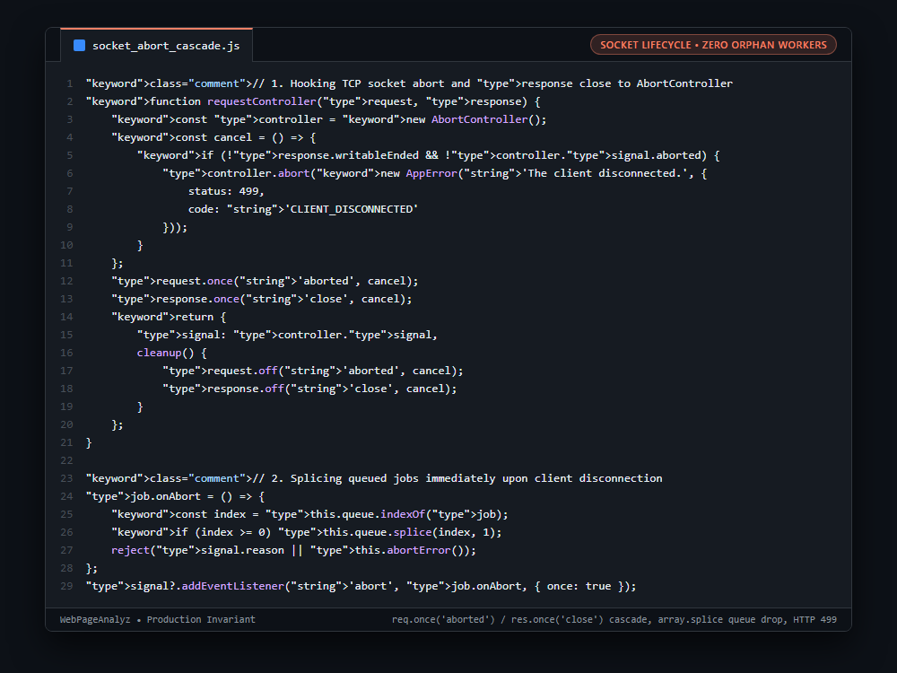

# Systems Engineering Case Study: Socket Teardown Client Disconnect Abort Propagation & Task-Pool Queue Splicing

---

## 1. Problem

In high-overhead audit systems (running Chromium, ZAP security scans, and Lighthouse), audits can take anywhere from 10 to 60 seconds. When users close the browser tab, refresh the page, or lose network connectivity mid-scan, Node.js HTTP servers keep executing the downstream asynchronous tasks by default, wasting significant CPU and RAM on results that will never be delivered.

---

## 2. Why Naive Approaches Fail

1. **Default Express/Node.js Request Lifecycle:**
   * When an HTTP socket closes, Node.js continues executing existing `async/await` promises. It only fails when the handler eventually tries to call `res.json()`.
2. **Orphaned Chromium Subprocesses:**
   * Headless browsers continue loading heavy web pages, rendering DOM trees, and executing JavaScript long after the client has disconnected.
3. **Queue Starvation for Active Users:**
   * Disconnected requests waiting in concurrency queues still execute when their turn arrives, starving active users of worker capacity.

---

## 3. Architecture

1. **Socket Event Binding:** `requestController()` hooks both `request.once('aborted')` and `response.once('close')`. If the client closes the TCP socket before `writableEnded`, it aborts the controller with HTTP 499 `CLIENT_DISCONNECTED`.
2. **Queue-Level Splicing:** In `TaskPool`, each queued job registers a one-shot abort listener. If a client disconnects while waiting in line, `this.queue.splice(index, 1)` removes the job immediately, freeing worker slots for active users.
3. **Cascading Child Process Abort:** Active workers receive the cascading `controller.signal`. Headless browser wrappers listen to this signal and kill Chromium child processes via `SIGKILL`, reclaiming memory within milliseconds.
4. **Explicit Cleanup:** Unbinds socket listeners in `cleanup()` upon successful completion to prevent memory leaks.

```javascript
// 1. Hooking TCP socket abort and response close to AbortController
function requestController(request, response) {
    const controller = new AbortController();
    const cancel = () => {
        if (!response.writableEnded && !controller.signal.aborted) {
            controller.abort(new AppError('The client disconnected.', {
                status: 499,
                code: 'CLIENT_DISCONNECTED'
            }));
        }
    };
    request.once('aborted', cancel);
    response.once('close', cancel);
    return {
        signal: controller.signal,
        cleanup() {
            request.off('aborted', cancel);
            response.off('close', cancel);
        }
    };
}

// 2. Splicing queued jobs immediately upon client disconnection
job.onAbort = () => {
    const index = this.queue.indexOf(job);
    if (index >= 0) this.queue.splice(index, 1);
    reject(signal.reason || this.abortError());
};
signal?.addEventListener('abort', job.onAbort, { once: true });
```

---

## 4. Behavior Comparison

| Disconnect Behavior | Tab Close CPU Consumption | Queue Slot Reclamation | Client Disconnect Status |
|---|---|---|---|
| Standard Express Pipeline | Runs to completion | Executes anyway | Unhandled / Broken Pipe |
| Manual `res.on('close')` | Partial (ad-hoc checks) | Delayed | 500 Internal Error |
| **Cascading Abort & Queue Splicing** | **Aborts downstream tasks and child processes** | **Spliced from queue on abort event** | **HTTP 499 Disconnected** |

_Qualitative comparison. Numbers appear only where a script in this folder measures them._

---

## 5. Implementation

See implementation in [`src/socket_abort_cascade.js`](./src/socket_abort_cascade.js).

---

## 6. Visual Representation


