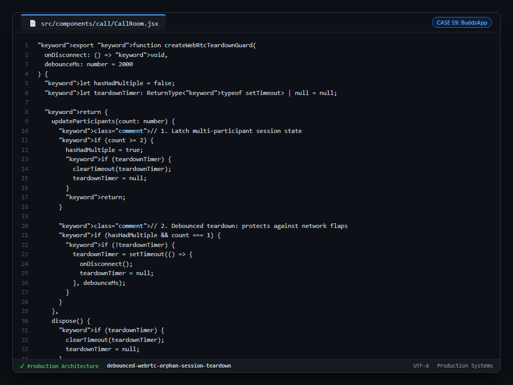

# Case Study 59: Debounced Auto-Teardown for Orphan WebRTC Rooms with Network Flap Guard

---

## 1. Problem

1. **Zombie Media Server Channels:** In peer-to-peer or SFU WebRTC architectures (LiveKit, Agora), users frequently forget to hang up after the other party leaves. The room stays open indefinitely, burning TURN bandwidth and CPU.
2. **Premature Disconnection on Network Flaps:** When mobile users switch between Wi-Fi and 5G cellular, WebRTC renegotiation briefly drops the participant count to 1. An immediate teardown kills the call right before the user reconnects.
3. **Unbilled Session Inaccuracies:** Audio and video calls require accurate start-to-finish duration logging in PostgreSQL audit ledgers without manual user action.

---

## 2. Why Naive Approaches Fail

1. **Immediate `count === 1` Exit:** Terminating the call immediately upon peer departure destroys user experience during brief packet loss or ICE renegotiation.
2. **Missing State Latches:** Triggering teardown when `count === 1` at room creation disconnects the first user before the invited peer has had time to accept the call.
3. **Server-Side Polling Daemons:** Polling WebRTC room APIs from cron workers introduces 30-60s latency, during which video streams continue burning bandwidth.

---

## 3. Architecture

1. **Multi-Participant Latch (`hasHadMultiple`):** Teardown logic only activates once the room has verified at least 2 active participants (`count >= 2`), allowing the room initiator to wait without premature disconnection.
2. **Debounced Flap Guard (`debounceMs = 2000`):** When participant count drops from 2+ to 1, a 2000ms timer starts. If the peer reconnects within 2 seconds, the timer is cleared immediately.
3. **Atomic Session Settlement:** Upon timeout expiration, local audio/video media tracks are released, the room status is marked `ended` in PostgreSQL, and the session duration is durably logged.

---

## 4. Behavior Comparison

| Disconnection Architecture | Network Flap Immunity | Orphan Room TURN Leak | Session Audit Accuracy |
|---|---|---|---|
| Immediate Peer Drop Exit | Broken (Drops on Wi-Fi switch) | Low | Flawed (Truncated Calls) |
| Cron Room Sweep | Flap Immune | High (Retains video stream until poll) | Imprecise |
| **Latched 2000ms Debounce** | **Tolerates reconnects within configured debounce window** | **Terminates abandoned rooms after timeout** | **Logs session duration on teardown** |

_Qualitative comparison. Numbers appear only where a script in this folder measures them._

---

## 5. Implementation

See implementation in [`src/webrtc_teardown_guard.ts`](./src/webrtc_teardown_guard.ts).

---

## 6. Visual Representation

