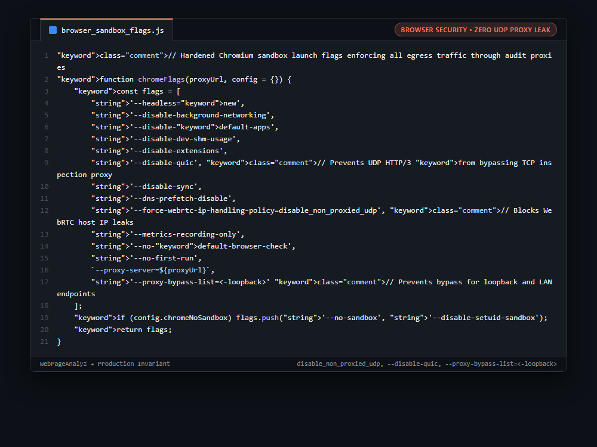

# Systems Engineering Case Study: Chromium Network Sandboxing: WebRTC UDP Leak Mitigation & QUIC Disablement

---

## 1. Problem

When routing automated headless Chromium crawlers through an egress security inspection proxy (`--proxy-server=http://proxy:8080`), Chromium by default can bypass the proxy across multiple network protocols:
1. **WebRTC STUN/TURN UDP Leak:** WebRTC initiates peer-to-peer UDP connections directly to external STUN servers, completely bypassing HTTP/SOCKS proxies and broadcasting the host worker's true public and internal IP addresses.
2. **HTTP/3 (QUIC) UDP Bypass:** Chromium defaults to HTTP/3 QUIC over UDP. Because most auditing proxies only inspect TCP, QUIC connections silently bypass inspection.
3. **Loopback Bypass List Defaults:** By default, Chromium excludes localhost and loopback interfaces from proxying, allowing untrusted target pages to probe internal services (`http://127.0.0.1:9222`).

---

## 2. Why Naive Approaches Fail

1. **Standard `--proxy-server` Flag Alone:**
   * Configures proxying only for standard TCP HTTP/HTTPS traffic. WebRTC and QUIC UDP sockets are left completely unproxied.
2. **Operating System Firewall Rules:**
   * Restricting UDP at the container iptables layer causes WebRTC connection timeouts, freezing browser page load scripts that await STUN candidate discovery.
3. **Default Proxy Bypass Defaults:**
   * Chromium's internal default bypass list includes `localhost`, `127.0.0.1`, and `[::1]`, creating SSRF exposure to local debugging ports.

---

## 3. Architecture

1. **WebRTC IP Policy Enforcement:** Configures `--force-webrtc-ip-handling-policy=disable_non_proxied_udp`. Forces WebRTC to route strictly through the configured proxy or disable non-proxied UDP candidates entirely, eliminating host IP leaks.
2. **QUIC Protocol Disablement:** Enforces `--disable-quic`, forcing all modern HTTP/3 connections to gracefully negotiate down to audited HTTP/2 and HTTP/1.1 TCP streams.
3. **Mandatory Loopback Proxying:** Passes `--proxy-bypass-list=<-loopback>`. The `<-loopback>` syntax explicitly clears the default loopback bypass list, forcing even requests targeting `127.0.0.1` through the security proxy for validation and SSRF filtering.
4. **Isolation Hardening:** Bundles `--dns-prefetch-disable`, `--disable-background-networking`, and `--disable-dev-shm-usage` to prevent covert channel communication.

```javascript
// Hardened Chromium sandbox launch flags enforcing all egress traffic through audit proxies
function chromeFlags(proxyUrl, config = {}) {
    const flags = [
        '--headless=new',
        '--disable-background-networking',
        '--disable-default-apps',
        '--disable-dev-shm-usage',
        '--disable-extensions',
        '--disable-quic', // Prevents UDP HTTP/3 from bypassing TCP inspection proxy
        '--disable-sync',
        '--dns-prefetch-disable',
        '--force-webrtc-ip-handling-policy=disable_non_proxied_udp', // Blocks WebRTC host IP leaks
        '--metrics-recording-only',
        '--no-default-browser-check',
        '--no-first-run',
        `--proxy-server=${proxyUrl}`,
        '--proxy-bypass-list=<-loopback>' // Prevents bypass for loopback and LAN endpoints
    ];
    if (config.chromeNoSandbox) flags.push('--no-sandbox', '--disable-setuid-sandbox');
    return flags;
}
```

---

## 4. Behavior Comparison

| Headless Browser Network Mode | WebRTC Real IP Leakage | HTTP/3 QUIC Proxy Bypass | Localhost SSRF Defense |
|---|---|---|---|
| Standard `--proxy-server` | Vulnerable (UDP Leaked) | Vulnerable (UDP Bypasses Proxy) | Bypasses Proxy (Default) |
| Container Firewall Drop | High Latency / Freezes | TCP Fallback | Vulnerable |
| **Hardened Sandboxed Flags** | **Restricted (disable_non_proxied_udp)** | **Disabled (--disable-quic)** | **Blocked (<-loopback>)** |

_Qualitative comparison. Numbers appear only where a script in this folder measures them._

---

## 5. Implementation

See implementation in [`src/browser_sandbox_flags.js`](./src/browser_sandbox_flags.js).

---

## 6. Visual Representation


