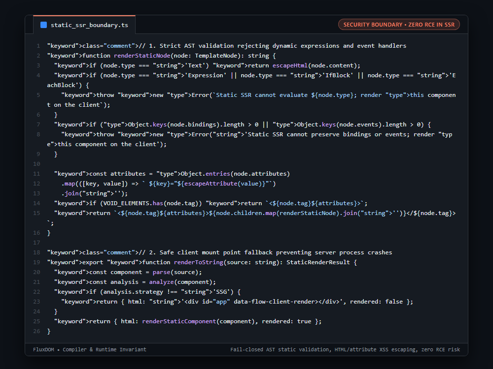

# Systems Engineering Case Study: Fail-Closed Static SSR Boundary & Server-Side RCE Elimination

## 1. The Production Constraint & Problem Statement
Server-Side Rendering (SSR) in component frameworks typically evaluates component JavaScript on the backend Node.js thread. If untrusted users or CMS contributors submit component markup containing expressions (e.g. `{process.exit()}` or `{require('child_process').exec(...)}`), evaluating this template on the server grants attackers full Remote Code Execution (RCE) on backend infrastructure.

---

## 2. Why Naive Workarounds Fail in Production
1. **Arbitrary Code Evaluation in SSR:**
   * Running `eval()` or executing compiled JS in SSR environments executes untrusted code with full server process permissions.
2. **Partial Render Leakage:**
   * Silently dropping dynamic directives in SSR produces broken HTML that causes jarring visual shifts when client hydration executes.
3. **XSS via Unescaped Attributes:**
   * Concatenating attribute strings without escaping double quotes and single quotes enables attribute breakout XSS attacks (`<div title="${input}">`).

---

## 3. The Architecture & Algorithmic Invariants
1. **AST AST Rejection of Dynamic Directives:** `renderStaticNode()` inspects template node types. If it encounters `Expression`, `IfBlock`, `EachBlock`, or dynamic `bindings`/`events`, it immediately throws without evaluating code.
2. **Fail-Closed Fallback Mount Point:** The SSR helper catches dynamic components and returns a safe client-rendered placeholder: `<div id="app" data-flow-client-render></div>`.
3. **Rigorous HTML & Attribute Escaping:**
   * `escapeHtml()`: Sanitizes `&`, `<`, `>`.
   * `escapeAttribute()`: Replaces `"` with `&quot;` and `'` with `&#39;`, blocking attribute breakout injection.
4. **Zero RCE Exposure:** The server stringifier never invokes `new Function()` or `eval()`. It operates purely on static string AST representations.

```typescript
// 1. Strict AST validation rejecting dynamic expressions and event handlers
function renderStaticNode(node: TemplateNode): string {
  if (node.type === 'Text') return escapeHtml(node.content);
  if (node.type === 'Expression' || node.type === 'IfBlock' || node.type === 'EachBlock') {
    throw new Error(`Static SSR cannot evaluate ${node.type}; render this component on the client`);
  }
  if (Object.keys(node.bindings).length > 0 || Object.keys(node.events).length > 0) {
    throw new Error('Static SSR cannot preserve bindings or events; render this component on the client');
  }

  const attributes = Object.entries(node.attributes)
    .map(([key, value]) => ` ${key}="${escapeAttribute(value)}"`)
    .join('');
  if (VOID_ELEMENTS.has(node.tag)) return `<${node.tag}${attributes}>`;
  return `<${node.tag}${attributes}>${node.children.map(renderStaticNode).join('')}</${node.tag}>`;
}

// 2. Safe client mount point fallback preventing server process crashes
export function renderToString(source: string): StaticRenderResult {
  const component = parse(source);
  const analysis = analyze(component);
  if (analysis.strategy !== 'SSG') {
    return { html: '<div id="app" data-flow-client-render></div>', rendered: false };
  }
  return { html: renderStaticComponent(component), rendered: true };
}
```

---

## 4. Behavior Comparison
| SSR Execution Model | RCE Vulnerability Surface | Unescaped XSS Risk | Dynamic Template Behavior |
|---|---|---|---|
| Full Node.js `eval()` SSR | Critical (Arbitrary Code Exec) | Moderate | Executes Arbitrary Code |
| Silent Drop Fallback | None | High | Broken HTML Layout Shift |
| **Fail-Closed Static AST Boundary** | **Code Never Evaluated** | **Escaped (HTML/Attr)** | **Safe Client Mount Point** |

_Qualitative comparison. Numbers appear only where a script in this folder measures them._

---

## 5. Visual Representation (Raw VS Code Crop)

