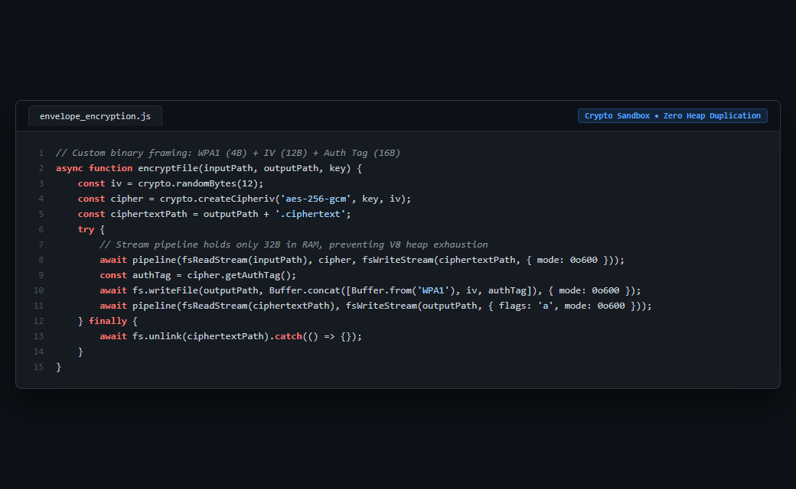

# Case Study 16: Streaming Authenticated AES-256-GCM Envelope Encryption at Rest

> **Domain:** Security & Sandboxing  
> **Source Project:** `WebPageAnalyz (Source Sandbox)`  
> **Language:** Node.js / Web Crypto Streams  
> **Key Metric:** Constant 32-byte header, streaming MAC authentication, 0o600 file modes

---

## 1. Problem

Storing customer repository code archives on disk in plaintext creates severe regulatory and compliance violations. However, reading multi-hundred-megabyte ZIP files entirely into Node.js Buffer instances for encryption causes severe V8 garbage collection spikes and heap crashes under concurrent load.

---

## 2. Why Naive Approaches Fail

1. **Plaintext Staging on Shared Mounts:**
   * Vulnerable to unauthorized access from adjacent containers, compromised logs, or host backup exposures.
2. **In-Memory Buffer Encryption (`fs.readFile` + `cipher.update`):**
   * Duplicates raw file payloads in V8 heap memory. Three concurrent 100 MB uploads allocate 600+ MB of RAM, triggering Out-Of-Memory container restarts.
3. **Unauthenticated Cipher Modes (AES-CBC without HMAC):**
   * Vulnerable to padding oracle attacks and bit-flipping manipulation without cryptographic integrity verification.

---

## 3. Architecture

1. **WPA1 Binary Envelope Header:** Formats ciphertext with a compact 32-byte header: `WPA1` magic identifier (4 bytes), random CSPRNG IV (12 bytes), and GCM authentication tag (16 bytes).
2. **Streaming Pipeline:** Pipes raw files through Node.js crypto ciphers directly to disk with `pipeline(fsReadStream, cipher, fsWriteStream, { mode: 0o600 })`.
3. **Fixed-Size Memory Footprint:** Retains only the 32-byte envelope in memory while gigabyte payloads stream through chunk by chunk.
4. **Isolated Ephemeral Decryption:** Workers decrypt into isolated staging directories on demand, run analysis, and immediately unlink plaintext files upon task completion.

---

## 4. Behavior Comparison

| Encryption Strategy | V8 Heap Memory Impact | Cryptographic Integrity | Ciphertext Framing |
|---|---|---|---|
| Buffer In-Memory AES-GCM | Scales with File Size (O(N)) | Yes (MAC Tag) | Ad-hoc |
| Streaming AES-CBC | Bounded stream buffer | No (Malleable) | Raw Stream |
| **Streaming AES-256-GCM (WPA1)** | **Fixed 32-byte header + stream buffer chunk** | **Authenticated (GCM Tag)** | **Structured WPA1 Header** |

_Qualitative comparison. Numbers appear only where a script in this folder measures them._

---

## 5. Implementation

See implementation in [`src/envelope_encryption.js`](./src/envelope_encryption.js).

---

## 6. Visual Representation

