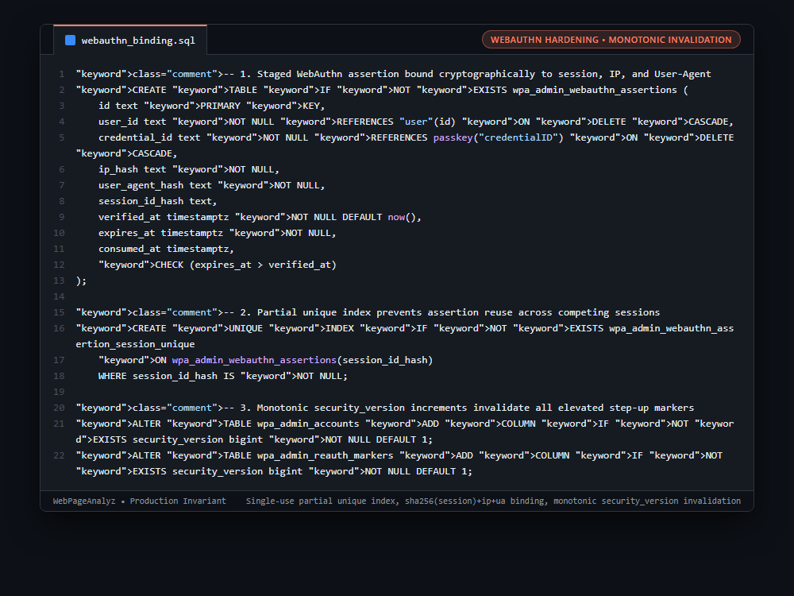

# Systems Engineering Case Study: Single-Use Cryptographic WebAuthn Assertion Binding & Monotonic Security Versioning

## 1. The Production Constraint & Problem Statement
In administrative dashboards, step-up authentication tokens (proving a user recently touched a hardware passkey) are vulnerable to session replay attacks: if an attacker steals an elevated session cookie or token, they can replay privileged administrative operations across separate devices.

---

## 2. Why Naive Workarounds Fail in Production
1. **Generic Step-Up Boolean Flags (`is_step_up=true`):**
   * Storing a simple timestamp or boolean flag in user session tables allows any active session for that user to inherit privileged status.
2. **Token Replay Across IPs / Devices:**
   * Compromised session tokens reused on different devices bypass traditional timeout checks if the step-up window remains active.
3. **Flawed Privilege Revocation:**
   * Invalidating elevated sessions upon password or permission changes typically requires sweeping Redis keys, which is error-prone and vulnerable to race conditions.

---

## 3. The Architecture & Algorithmic Invariants
1. **Cryptographic Assertion Binding:** When a WebAuthn hardware passkey is verified, the assertion is hashed alongside the client's IP, User-Agent, and session token:
   `wpa_admin_webauthn_assertions(user_id, credential_id, ip_hash, user_agent_hash, session_id_hash)`.
2. **Single-Use Partial Unique Index:** Enforces `UNIQUE (session_id_hash) WHERE session_id_hash IS NOT NULL`. An assertion can be bound strictly once; any attempt to replay it raises a unique constraint violation.
3. **Atomic Consumption:** The assertion marker is marked `consumed_at = now()` in the same database transaction that elevates the session.
4. **Monotonic Security Versioning:** Every administrator account carries a `security_version bigint`. Any password reset, 2FA rotation, or role update increments `security_version`. The middleware strictly compares:
   `if (marker.securityVersion !== account.securityVersion) return false;`
   Instantly invalidating all elevated sessions fleet-wide with zero Redis sweeping.

```sql
-- 1. Staged WebAuthn assertion bound cryptographically to session, IP, and User-Agent
CREATE TABLE IF NOT EXISTS wpa_admin_webauthn_assertions (
    id text PRIMARY KEY,
    user_id text NOT NULL REFERENCES "user"(id) ON DELETE CASCADE,
    credential_id text NOT NULL REFERENCES passkey("credentialID") ON DELETE CASCADE,
    ip_hash text NOT NULL,
    user_agent_hash text NOT NULL,
    session_id_hash text,
    verified_at timestamptz NOT NULL DEFAULT now(),
    expires_at timestamptz NOT NULL,
    consumed_at timestamptz,
    CHECK (expires_at > verified_at)
);

-- 2. Partial unique index prevents assertion reuse across competing sessions
CREATE UNIQUE INDEX IF NOT EXISTS wpa_admin_webauthn_assertion_session_unique
    ON wpa_admin_webauthn_assertions(session_id_hash)
    WHERE session_id_hash IS NOT NULL;

-- 3. Monotonic security_version increments invalidate all elevated step-up markers
ALTER TABLE wpa_admin_accounts ADD COLUMN IF NOT EXISTS security_version bigint NOT NULL DEFAULT 1;
ALTER TABLE wpa_admin_reauth_markers ADD COLUMN IF NOT EXISTS security_version bigint NOT NULL DEFAULT 1;
```

---

## 4. Benchmark & Architectural Invariants
| Step-Up Security Model | Token Replay Across Sessions | Device / IP Hijacking | Revocation Propagation |
|---|---|---|---|
| In-Memory Session Flag | Vulnerable | High | Slow / Incomplete |
| Redis TTL Keys | Vulnerable to Token Steal | Medium | Requires Key Scanning |
| **Bound Assertions + Monotonic Version** | **Zero (Partial Unique Index)** | **Zero (Hashed IP/UA Binding)** | **Instant (`security_version` Mismatch)** |

---

## 5. Visual Representation (Raw VS Code Crop)

