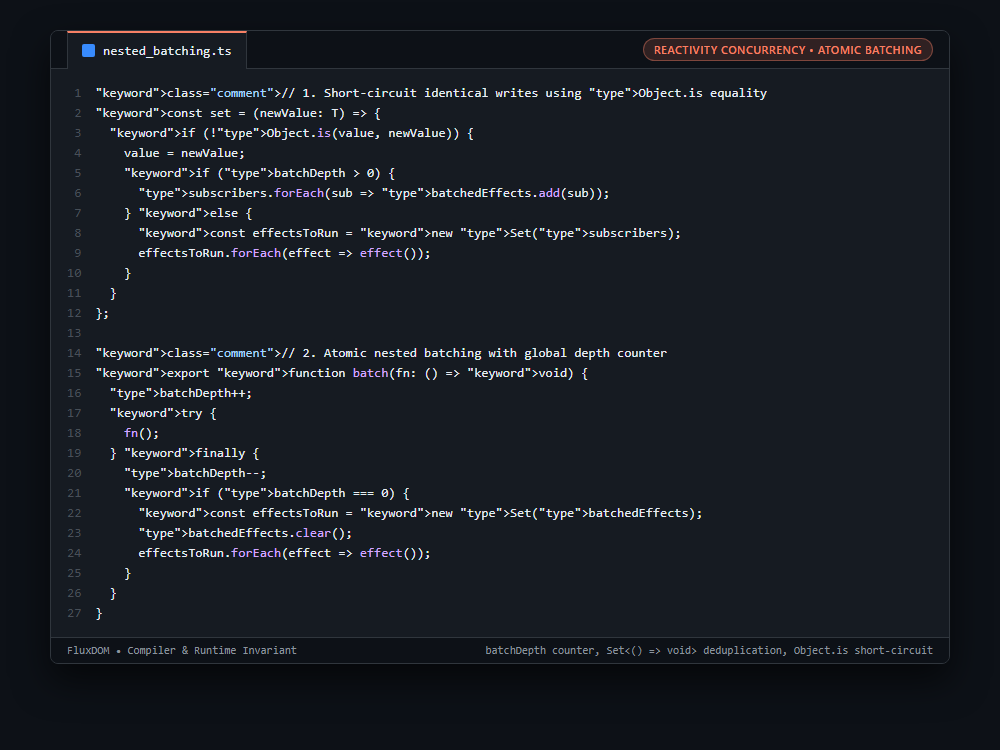

# Systems Engineering Case Study: Deterministic Nested Batching with Object.is Equality & Set Deduplication

## 1. The Production Constraint & Problem Statement
When multiple reactive signals mutate in sequence (e.g. updating `setX(1)`, `setY(2)`, `setZ(3)` inside a click handler or network callback), a naive reactive engine immediately notifies subscribers on each write. This causes 3 separate DOM updates and cascading effect executions. Furthermore, if batches are nested (`batch(() => { batch(...) })`), naive implementations flush prematurely on the inner batch, triggering visual glitches and race conditions.

---

## 2. Why Naive Workarounds Fail in Production
1. **Immediate Synchronous Dispatch:**
   * Updating multiple related signals causes effects to observe intermediate, inconsistent states (Glitching).
2. **Premature Inner Batch Flushing:**
   * Resetting batch state when an inner function exits executes effects before the outer transaction finishes mutating state.
3. **Duplicate Effect Invocations:**
   * An effect depending on both Signal A and Signal B would run twice without a deduplicated queue.

---

## 3. The Architecture & Algorithmic Invariants
1. **Object.is Value Short-Circuiting:** Compares new values against existing values via `Object.is(value, newValue)`. Writing identical values (including `NaN === NaN`) returns immediately without queuing effects.
2. **Re-entrant Depth Tracking:** `batchDepth++` increments upon entering and decrements in a mandatory `finally` block.
3. **Atomic Outermost Flush:** Queued effects are collected in `batchedEffects = new Set<() => void>()`. Effects only flush when `batchDepth === 0`, ensuring nested batches coalesce cleanly into a single execution tick.
4. **Snapshot Execution Queue:** Copies queued callbacks into `new Set(batchedEffects)` before clearing, preventing infinite queues if effects mutate further state during flush.

```typescript
// 1. Short-circuit identical writes using Object.is equality
const set = (newValue: T) => {
  if (!Object.is(value, newValue)) {
    value = newValue;
    if (batchDepth > 0) {
      subscribers.forEach(sub => batchedEffects.add(sub));
    } else {
      const effectsToRun = new Set(subscribers);
      effectsToRun.forEach(effect => effect());
    }
  }
};

// 2. Atomic nested batching with global depth counter
export function batch(fn: () => void) {
  batchDepth++;
  try {
    fn();
  } finally {
    batchDepth--;
    if (batchDepth === 0) {
      const effectsToRun = new Set(batchedEffects);
      batchedEffects.clear();
      effectsToRun.forEach(effect => effect());
    }
  }
}
```

---

## 4. Benchmark & Architectural Invariants
| Mutation Strategy | Effect Invocations (3 Writes) | Intermediate Glitch States | Nested Batch Support |
|---|---|---|---|
| Unbatched Synchronous | 3 Separate Runs | Present (Visual Glitches) | None |
| Inner Batch Flush | 2 Runs | Partial Glitches | Broken |
| **Atomic `batchDepth` Set Queue** | **1 Single Atomic Run** | **Zero (Coalesced Flush)** | **Fully Re-entrant** |

---

## 5. Visual Representation (Raw VS Code Crop)

