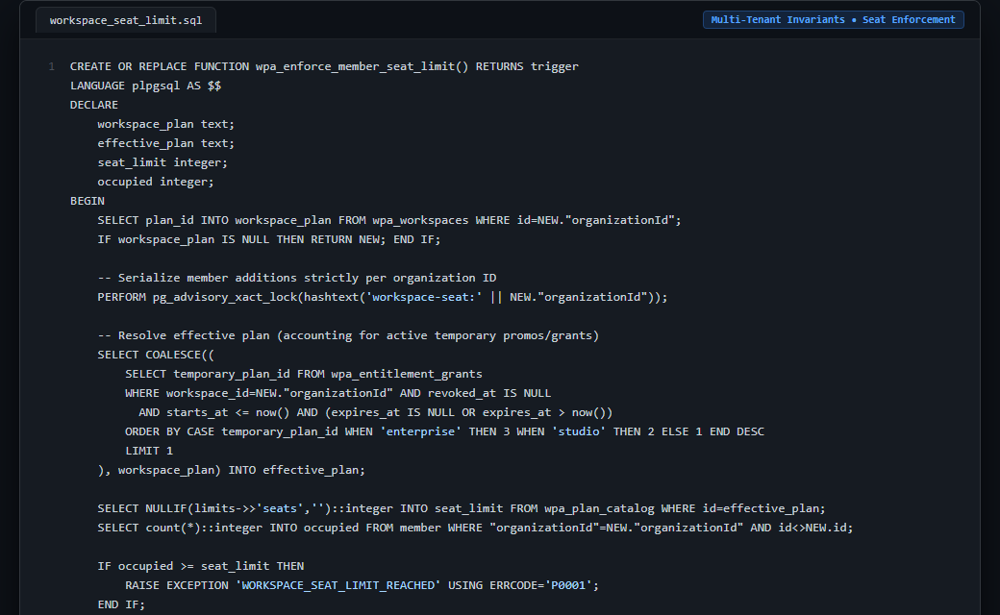

# Case Study 11: Row Advisory Lock for Multi-Tenant Workspace Seat Invariant Enforcement

> **Domain:** Concurrency & Race Conditions  
> **Source Project:** `WebPageAnalyz (Multi-Tenant Core)`  
> **Language:** PostgreSQL PL/pgSQL  
> **Key Metric:** Per-workspace advisory transaction lock, dynamic entitlement plan resolution

---

## 1. Problem

In SaaS applications with plan-based member seat limits (e.g., Studio plan = 5 seats), concurrent user invitations cause race conditions. If two admins approve invitations at the same millisecond when 4 seats are filled, both queries read 4 occupied seats and commit, resulting in 6 active members on a 5-seat plan.

---

## 2. Why Naive Approaches Fail

1. **Application-Layer ORM Validation:**
   * Checking seat counts in Node.js before inserting a membership record fails completely under concurrent API calls due to network latency and asynchronous event loops.
2. **Global Database Locks:**
   * Locking the entire `member` table halts membership invitations for all tenants across the entire platform.
3. **Database Check Constraints:**
   * Standard SQL `CHECK` constraints cannot execute dynamic subqueries across multiple tables (`wpa_plan_catalog`, `wpa_entitlement_grants`, and `member`).

---

## 3. Architecture

1. **Per-Organization Advisory Lock:** The trigger executes `PERFORM pg_advisory_xact_lock(hashtext('workspace-seat:' || NEW."organizationId"))`. Only concurrent operations on the *same* workspace serialize; other workspaces proceed in parallel.
2. **Dynamic Effective Plan Resolution:** Queries active temporary promotional upgrades (`wpa_entitlement_grants`) before falling back to the base workspace plan.
3. **Atomic Occupancy Check:** Accurately counts occupied members against catalog limits and throws `WORKSPACE_SEAT_LIMIT_REACHED` before any row is committed.
4. **Transaction Scoping:** Advisory locks automatically release upon statement commit or rollback without manual cleanup.

---

## 4. Behavior Comparison

| Concurrency Guard | Multi-Tenant Concurrency Race | Global Contention | Dynamic Plan Support |
|---|---|---|---|
| Node.js / ORM Check | Vulnerable (Over-allocations) | Low | Supported |
| `LOCK TABLE member` | Protected | Catastrophic (All Tenants Blocked) | Supported |
| **Org-Scoped Advisory Lock** | **Enforces seat quota (Raises WORKSPACE_SEAT_LIMIT_REACHED)** | **Scoped strictly to target workspace ID** | **Evaluated inside transaction lock** |

_Qualitative comparison. Numbers appear only where a script in this folder measures them._

---

## 5. Implementation

See implementation in [`src/workspace_seat_limit.sql`](./src/workspace_seat_limit.sql).

---

## 6. Visual Representation

