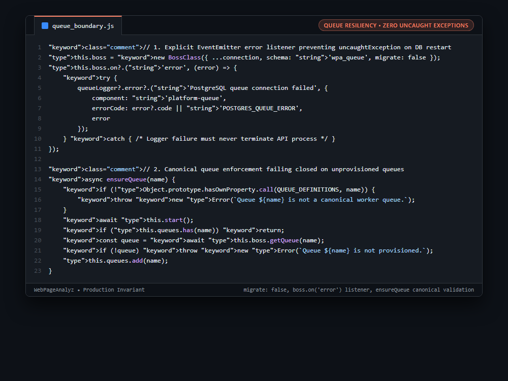

# Systems Engineering Case Study: Unhandled EventEmitter Swallowing & Fail-Closed Queue Provisioning

## 1. The Production Constraint & Problem Statement
In PostgreSQL-backed job queues (such as `pg-boss`), background idle connection drops or planned PostgreSQL maintenance restarts emit errors directly onto the `PgBoss` EventEmitter. In Node.js, an EventEmitter with an unhandled `error` event immediately triggers an `uncaughtException`, crashing the entire container. Furthermore, allowing workers or API processes to execute opportunistic DDL (`migrate: true`) causes schema migration deadlocks during multi-container rolling deployments.

---

## 2. Why Naive Workarounds Fail in Production
1. **Missing EventEmitter Error Handler:**
   * By default, `boss.on('error')` is not registered. When the database pool closes during a failover or restart, Node.js terminates with code 1.
2. **Opportunistic DDL on Application Boot:**
   * If API containers and worker containers both boot with auto-migration enabled, they race to create tables and execute `CREATE INDEX`, causing transaction deadlocks.
3. **Silent Dispatch to Typo Queues:**
   * Sending jobs to unprovisioned queues without validation causes jobs to sit silently in database tables without active workers.

---

## 3. The Architecture & Algorithmic Invariants
1. **Explicit Error Boundary:** Binds a top-level `this.boss.on('error', ...)` listener. Logs the event cleanly with error codes and absorbs transient network drops so the container remains alive during planned DB maintenance.
2. **No-Migration Runtime Invariant (`migrate: false`):** Disables auto-migration in application code. Queue schema creation is strictly isolated to dedicated deployment CI/CD migration scripts.
3. **Canonical Queue Validation (`ensureQueue`):**
   * Validates queue names against frozen `QUEUE_DEFINITIONS`. Unknown queues throw immediately.
   * Calls `await this.boss.getQueue(name)`. If a queue was not provisioned during release migration, it fails closed rather than failing silently.

```javascript
// 1. Explicit EventEmitter error listener preventing uncaughtException on DB restart
this.boss = new BossClass({ ...connection, schema: 'wpa_queue', migrate: false });
this.boss.on?.('error', (error) => {
    try {
        queueLogger?.error?.('PostgreSQL queue connection failed', {
            component: 'platform-queue',
            errorCode: error?.code || 'POSTGRES_QUEUE_ERROR',
            error
        });
    } catch { /* Logger failure must never terminate API process */ }
});

// 2. Canonical queue enforcement failing closed on unprovisioned queues
async ensureQueue(name) {
    if (!Object.prototype.hasOwnProperty.call(QUEUE_DEFINITIONS, name)) {
        throw new Error(`Queue ${name} is not a canonical worker queue.`);
    }
    await this.start();
    if (this.queues.has(name)) return;
    const queue = await this.boss.getQueue(name);
    if (!queue) throw new Error(`Queue ${name} is not provisioned.`);
    this.queues.add(name);
}
```

---

## 4. Behavior Comparison
| Queue Resiliency Model | DB Restart Behavior | Schema Lock Deadlocks | Unprovisioned Queue Catch |
|---|---|---|---|
| Default pg-boss Boot | Process Crashes (`uncaughtException`) | Frequent (`migrate: true`) | Silent Blackhole |
| Manual Try/Catch on Send | Crashes on Idle Pool Drop | Frequent | Partial |
| **Fail-Closed Boundary** | **Absorbed & Recovers Cleanly** | **Eliminated (Runtime uses `migrate: false`)** | **Immediate Fail-Closed Check** |

_Qualitative comparison. Numbers appear only where a script in this folder measures them._

---

## 5. Visual Representation (Raw VS Code Crop)

