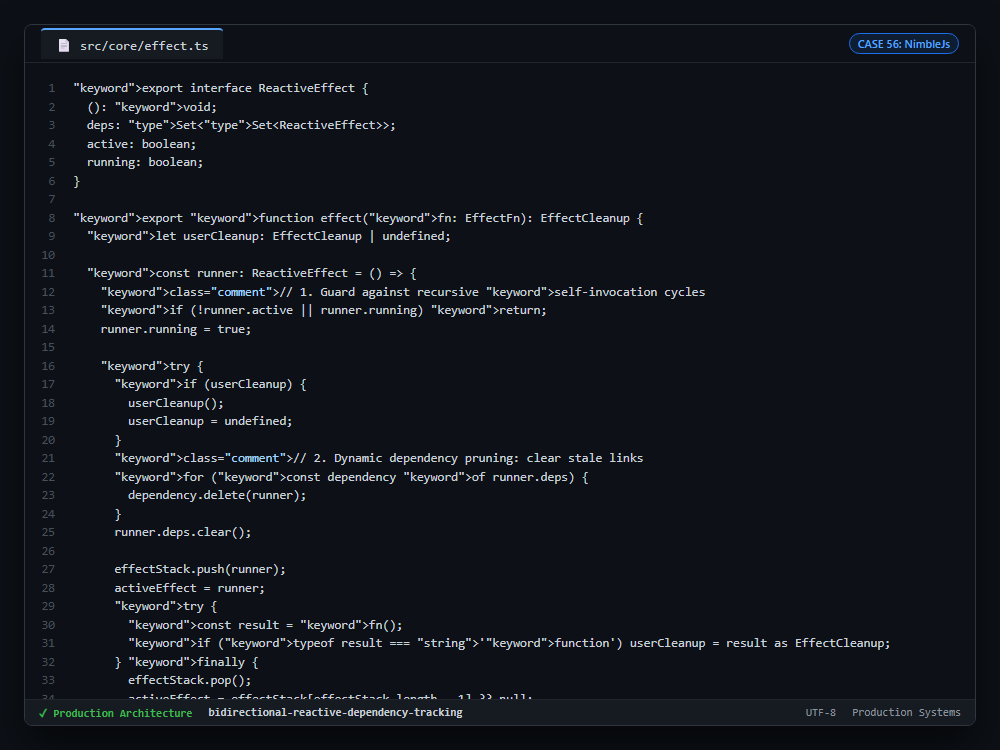

# Case Study 56: Bidirectional Reactive Dependency Tracking & Infinite Cycle Guard

---

## 1. Problem

1. **Zombie Subscriptions in Conditional Branches:** In reactive runtimes, evaluating ternary branches (`cond() ? a() : b()`) leaves stale subscriptions in dependencies that are no longer active, leaking memory.
2. **Infinite Recursion on Self-Mutating Effects:** If an effect writes to a signal that it also reads (`count(count() + 1)`), standard observers enter infinite recursion and exhaust the call stack.
3. **Missing Teardown Lifecycles:** Effects subscribing to external WebSockets, DOM event listeners, or timers require reliable execution of returned cleanup functions before re-evaluation or disposal.

---

## 2. Why Naive Approaches Fail

1. **One-Way Subscription Arrays:** Storing effects strictly on signal subscriber lists prevents the effect from knowing which signals to detach from when its execution path branches.
2. **Naive Re-Entry Flags:** Global boolean execution flags prevent any effect from triggering updates, halting unrelated state transitions across concurrent component boundaries.
3. **Manual Subscription Management:** Forcing developers to manually dispose listeners introduces memory leaks and boilerplate.

---

## 3. Architecture

1. **Bidirectional Dependency Tracking (`deps: Set<Set<ReactiveEffect>>`):** The effect holds a reference to every signal's subscriber set. Prior to each run, it deletes itself from every tracked dependency set and clears its internal list.
2. **Per-Runner Recursion Guard (`runner.running = true`):** Restricts recursion protection strictly to the active runner instance, avoiding global reactive pipeline freezes while preventing infinite self-invocation.
3. **Clean Teardown Guarantees:** Returns from effect functions are captured as `userCleanup` and executed before subsequent runs and upon unmount.

---

## 4. Behavior Comparison

| Reactive Runtime Strategy | Stale Branch Memory Leak | Self-Mutating Infinite Loop | Teardown Lifecycle Guarantee |
|---|---|---|---|
| Unchecked Listener Array | Leaked Subscriptions | Stack Overflow Crash | None (Manual Unbind) |
| Global Re-Entry Lock | Leaked Subscriptions | Deadlocks Concurrent Effects | Partial |
| **Bidirectional Set Tracking** | **Dynamic Pruning on Re-execution** | **Self-mutation suppressed (runner.running)** | **Per-Run Subscription Cleanup** |

_Qualitative comparison. Numbers appear only where a script in this folder measures them._

---

## 5. Implementation

See implementation in [`src/effect_tracking.ts`](./src/effect_tracking.ts).

---

## 6. Visual Representation

