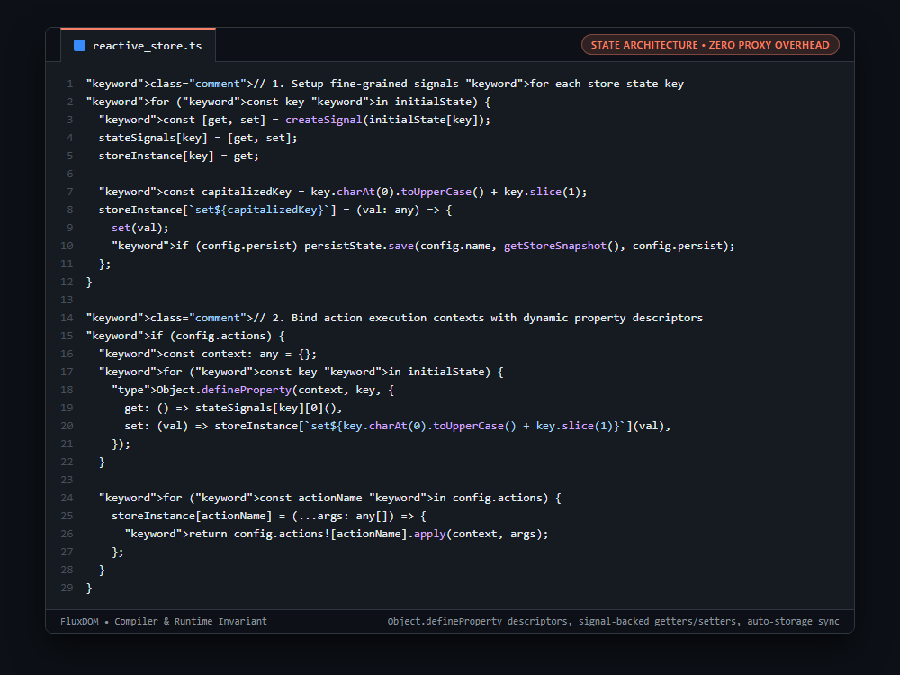

# Systems Engineering Case Study: Proxy-Less Reactive State Store with Dynamic Property Descriptors

## 1. The Production Constraint & Problem Statement
Global state management libraries often rely on ES6 `Proxy` objects or Redux-style action dispatchers with reducers. ES6 Proxies add property lookup overhead and trap performance penalties across thousands of reads in hot loops. Meanwhile, Redux-style immutable stores require repetitive action creators and full object cloning on every mutation.

---

## 2. Why Naive Workarounds Fail in Production
1. **Proxy Trap Performance Tax:**
   * Intercepting every property access through deep Proxy handlers slows down execution in render loops.
2. **Boilerplate Reducer Overhead:**
   * Dispatching actions through reducers creates unnecessary object cloning and event loop churn.
3. **Disconnected Storage Persistence:**
   * Syncing state to `localStorage` or `sessionStorage` typically requires third-party middleware prone to state desynchronization.

---

## 3. The Architecture & Algorithmic Invariants
1. **Signal-Backed Property Map:** Each state property maps to an isolated `createSignal()` tuple (`[get, set]`).
2. **Dynamic Context Descriptors:** `Object.defineProperty(context, key, ...)` defines getters and setters on the action `this` context:
   * Reading `this.count` calls `get()`.
   * Mutating `this.count = 5` calls `store.setCount(5)`.
3. **Zero Proxy Overhead:** Operations execute as direct function calls and native V8 property lookups without proxy trapping.
4. **Integrated Storage Persistence:** When `persist: 'local' | 'session'` is configured, setter invocations automatically serialize state snapshots to web storage.

```typescript
// 1. Setup fine-grained signals for each store state key
for (const key in initialState) {
  const [get, set] = createSignal(initialState[key]);
  stateSignals[key] = [get, set];
  storeInstance[key] = get;

  const capitalizedKey = key.charAt(0).toUpperCase() + key.slice(1);
  storeInstance[`set${capitalizedKey}`] = (val: any) => {
    set(val);
    if (config.persist) persistState.save(config.name, getStoreSnapshot(), config.persist);
  };
}

// 2. Bind action execution contexts with dynamic property descriptors
if (config.actions) {
  const context: any = {};
  for (const key in initialState) {
    Object.defineProperty(context, key, {
      get: () => stateSignals[key][0](),
      set: (val) => storeInstance[`set${key.charAt(0).toUpperCase() + key.slice(1)}`](val),
    });
  }

  for (const actionName in config.actions) {
    storeInstance[actionName] = (...args: any[]) => {
      return config.actions![actionName].apply(context, args);
    };
  }
}
```

---

## 4. Behavior Comparison
| State Management Pattern | Property Access Overhead | Boilerplate Action Reducers | Storage Persistence |
|---|---|---|---|
| Redux / Flux | High (Cloned Objects) | Mandatory (Actions/Reducers) | Middleware Required |
| MobX / Vue Reactive (Proxy) | Medium (Proxy Traps) | Low | Custom Plugins |
| **FluxDOM Signal Descriptors** | **Minimal (Native V8 Getters)** | **Direct property mutation (`this.x++`)** | **Descriptor-driven persistence** |

_Qualitative comparison. Numbers appear only where a script in this folder measures them._

---

## 5. Visual Representation (Raw VS Code Crop)

