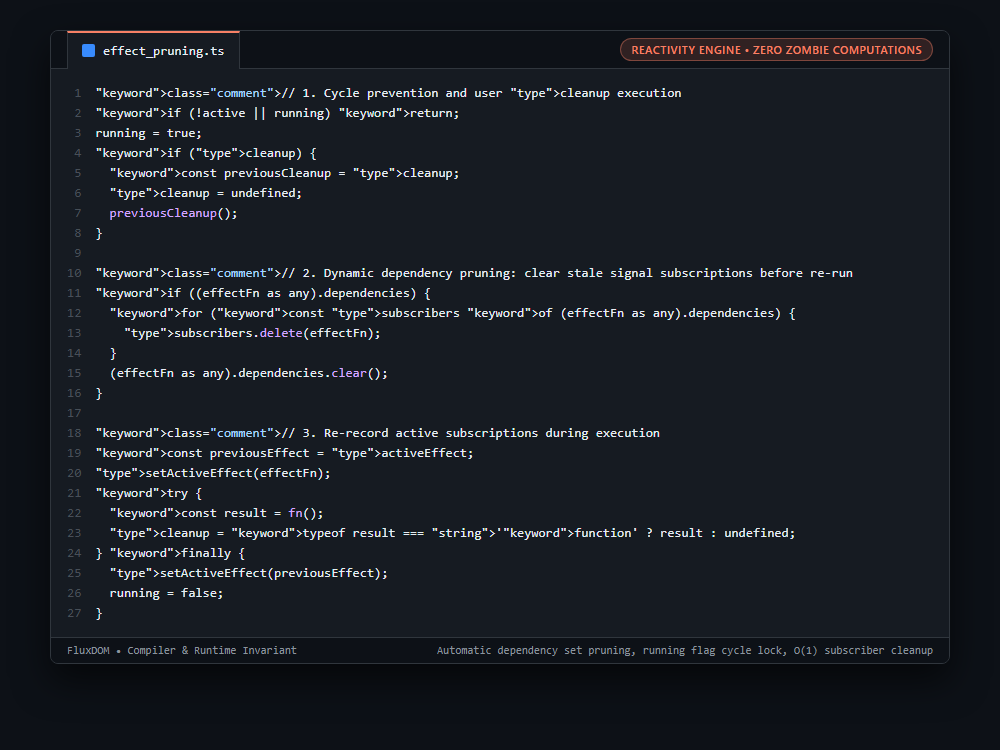

# Systems Engineering Case Study: Dynamic Dependency Pruning & Zombie Computation Elimination in Fine-Grained Signals

## 1. The Production Constraint & Problem Statement
In fine-grained reactive runtimes (such as Solid, Svelte, or Vue), an effect that evaluates dynamic conditional branches (`condition() ? signalA() : signalB()`) subscribes to whichever signal is read. If `condition` later flips from `true` to `false`, naive subscription graphs keep the effect permanently registered in `signalA`'s subscriber set. Subsequent updates to `signalA` continue triggering the effect unnecessarily (Zombie Computation), leaking memory and executing stale work.

---

## 2. Why Naive Workarounds Fail in Production
1. **Static Dependency Registration:**
   * Subscribing once during initialization fails to reflect changing branches, causing effects to execute on irrelevant state mutations.
2. **Memory Leakage Across Component Trees:**
   * Retaining references to unread signals prevents garbage collection of detached DOM nodes and parent scopes.
3. **Infinite Re-Entrant Loops:**
   * If an effect updates a signal it inadvertently reads, missing recursion guards (`running`) cause fatal call stack overflow crashes.

---

## 3. The Architecture & Algorithmic Invariants
1. **Pre-Execution Subscription Disposal:** Before re-evaluating `fn()`, the effect traverses `dependencies` (a `Set<Set<() => void>>`) and deletes itself from every signal's subscriber set, then calls `dependencies.clear()`.
2. **Fresh Dependency Recording:** As `fn()` executes under `setActiveEffect(effectFn)`, only signals actually evaluated in the active branch add `effectFn` back to their subscriber sets.
3. **Deterministic Cleanup Hook:** Executes the previous execution's returned cleanup callback before re-running, ensuring timers, DOM listeners, or abort signals are torn down cleanly.
4. **Recursion Lock:** Enforces `let running = false` to prevent an effect from triggering itself in an infinite re-entrant cycle.

```typescript
// 1. Cycle prevention and user cleanup execution
if (!active || running) return;
running = true;
if (cleanup) {
  const previousCleanup = cleanup;
  cleanup = undefined;
  previousCleanup();
}

// 2. Dynamic dependency pruning: clear stale signal subscriptions before re-run
if ((effectFn as any).dependencies) {
  for (const subscribers of (effectFn as any).dependencies) {
    subscribers.delete(effectFn);
  }
  (effectFn as any).dependencies.clear();
}

// 3. Re-record active subscriptions during execution
const previousEffect = activeEffect;
setActiveEffect(effectFn);
try {
  const result = fn();
  cleanup = typeof result === 'function' ? result : undefined;
} finally {
  setActiveEffect(previousEffect);
  running = false;
}
```

---

## 4. Benchmark & Architectural Invariants
| Reactivity Model | Ternary Branch Invariance | Zombie Computation Risk | Teardown Memory Leak |
|---|---|---|---|
| Naive Subscriptions | Broken (Stale Subscriptions) | Critical (Runs Stale Branches) | High |
| WeakMap Caching | Partial | Medium | Complex GC Overhead |
| **Dynamic Set Pruning** | **100% Deterministic** | **Zero (Cleaned Before Run)** | **Immediate (`subscribers.delete`)** |

---

## 5. Visual Representation (Raw VS Code Crop)

