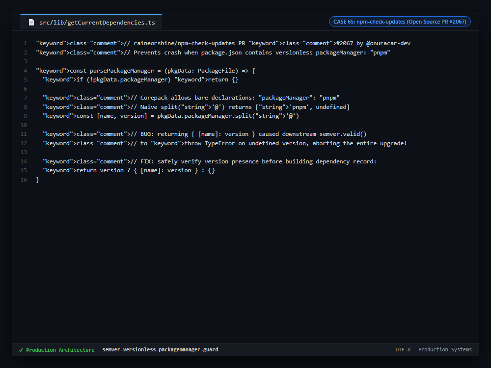

# Case Study 65: Versionless packageManager Declaration Guard Against SemVer Crashes

---

## 1. Problem

1. **Crash on Corepack Bare Declarations:** Node.js Corepack and modern package managers allow bare declarations like `"packageManager": "pnpm"` or `"packageManager": "yarn"` without an `@version` suffix in `package.json`.
2. **Fatal TypeError in SemVer Upgrade Loops:** Dependency upgrade utilities (like `npm-check-updates`) splitting by `@` received `undefined` for the version token, passing it into SemVer comparison functions that threw unhandled exceptions and crashed the CLI tool.
3. **Accidental Modification of User Configuration:** Failing to account for versionless fields caused parsers to overwrite or delete valid user configuration.

---

## 2. Why Naive Approaches Fail

1. **Unchecked String Splitting:** Assuming `packageManager` always adheres to the `name@version` specification.
2. **Throwing on Unsupported Syntax:** Crashing the entire dependency upgrade process for the repository because of an optional tooling field.
3. **Regex Extraction without Fallbacks:** Using strict regular expressions that fail to match bare names, leaving the dependency in an undefined state.

---

## 3. Architecture

1. **Safe Conditional Mapping:** `parsePackageManager` splits the string and verifies that `version` is truthy before returning a dependency entry.
2. **Preservation of Existing Fields:** If no version is specified, an empty dictionary is returned, allowing `npm-check-updates` to continue upgrading all regular dependencies without modifying or corrupting the bare `packageManager` entry.
3. **End-to-End Regression Test Suite:** Validated via Vitest suites ensuring `packageManager: "pnpm"` remains intact while `dependencies` upgrade seamlessly.

---

## 4. Behavior Comparison

| Dependency Parser Handling | Versionless `packageManager` Crash | Regular Dependencies Upgraded | CLI Exit Code |
|---|---|---|---|
| Unchecked Split (`split('@')`) | Fatal Crash (`TypeError: undefined`) | 0 (Aborted Run) | Exit 1 (Fatal) |
| Strip Unknown Fields | Corrupts `package.json` | Upgraded | Exit 0 (Corrupted) |
| **Conditional Guard (`version ? ... : {}`)** | **Safely skipped without crashing** | **Valid dependencies upgraded** | **Exit 0 (Success)** |

_Qualitative comparison. Numbers appear only where a script in this folder measures them._

---

## 5. Implementation

See implementation in [`src/package_manager_parser.ts`](./src/package_manager_parser.ts).

---

## 6. Visual Representation

