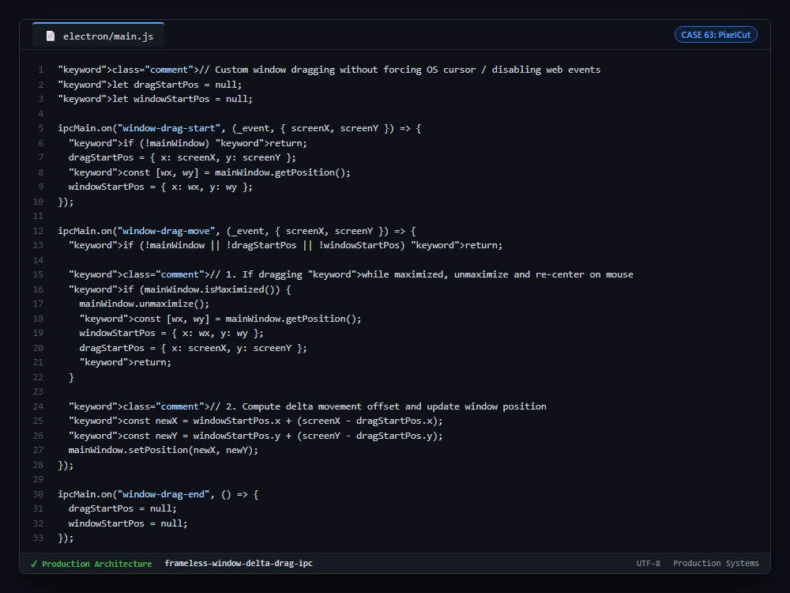

# Case Study 63: Custom Delta-Offset IPC Window Dragging in Frameless Desktop Apps

---

## 1. Problem

1. **CSS `-webkit-app-region: drag` Event Hijacking:** In custom frameless Electron desktop apps (`frame: false`), applying CSS drag regions breaks HTML DOM click handlers, text selection, buttons, and custom context menus on Windows.
2. **Cursor Snapping Glitches on Maximized Windows:** Dragging a maximized window down from the top bar snaps the window violently to screen coordinates (0, 0) or freezes the mouse pointer.
3. **Double-Click Titlebar Conflicts:** Drag regions intercept double-click events, preventing users from maximizing or restoring windows via standard OS titlebar gestures.

---

## 2. Why Naive Approaches Fail

1. **Native CSS Drag Regions:** Electron's Chromium implementation routes native drag regions directly to Windows OS window manager hooks, completely bypassing the web renderer event loop.
2. **Absolute Screen Positioning:** Directly setting `setPosition(screenX, screenY)` places the top-left corner of the window under the mouse cursor instead of preserving the grab offset.
3. **Polling Mouse Coordinates:** Running `screen.getCursorScreenPoint()` on high-frequency timers burns background CPU and introduces lag.

---

## 3. Architecture

1. **Delta Offset Calculation (`screenX - dragStartPos.x`):** Captures initial mouse coordinates and window origin on `window-drag-start`. Incremental moves update coordinates relative to the initial offset, ensuring natural physics.
2. **Atomic Unmaximize Coordinate Re-Anchoring:** When dragging a maximized window, `unmaximize()` is invoked, and the origin offsets are instantly reset to the cursor position to prevent teleportation.
3. **Full Web Renderer Control:** All dragging occurs via lightweight IPC events, allowing web buttons, dropdowns, and search bars to remain fully interactive inside the custom titlebar.

---

## 4. Behavior Comparison

| Frameless Window Dragging Mechanism | DOM Click / Button Responsiveness | Maximized Drag Smoothness | Pointer Capture Stability |
|---|---|---|---|
| CSS `-webkit-app-region: drag` | Broken (Swallows DOM Events) | Glitchy (OS Snap Freezes) | Unstable on Windows |
| Polling Timer (`setInterval`) | High Latency (Jitter) | Poor (Drifts from Cursor) | High CPU Overhead |
| **Delta-Offset IPC Messaging** | **Interactive titlebar (DOM events preserved)** | **Smooth (Re-Anchored Coordinates)** | **Stable coordinate calculation** |

_Qualitative comparison. Numbers appear only where a script in this folder measures them._

---

## 5. Implementation

See implementation in [`src/window_dragging_ipc.ts`](./src/window_dragging_ipc.ts).

---

## 6. Visual Representation

