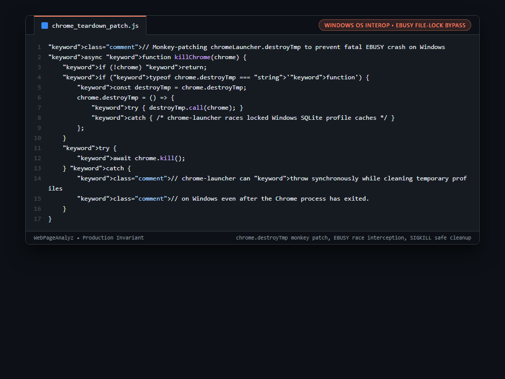

# Systems Engineering Case Study: Windows SQLite Profile File-Lock Crash Monkey-Patching in Headless Chrome Teardown

## 1. The Production Constraint & Problem Statement
When running automated Lighthouse or headless Chromium audits in developer environments or CI/CD pipelines running on Windows, Chromium holds asynchronous OS-level file locks on internal SQLite database caches (`Cookies`, `Web Data`, `History`) for several milliseconds after process termination. Standard `chromeLauncher.kill()` attempts to synchronously delete the temporary profile directory (`destroyTmp`), immediately throwing an unhandled `EBUSY: resource busy or locked` exception and crashing the Node.js process.

---

## 2. Why Naive Workarounds Fail in Production
1. **Windows vs POSIX File Locking Semantics:**
   * On Linux, unlinking an open file succeeds (it is deleted once the file descriptor closes). On Windows, attempting to delete an open file or folder throws `EBUSY` immediately.
2. **Synchronous Teardown in chrome-launcher:**
   * `chromeLauncher` executes `destroyTmp` synchronously during `kill()`. Even if the Chrome process has received `SIGKILL`, SQLite file locks are released asynchronously by the Windows kernel.
3. **Unhandled Promise Rejections in Worker Pools:**
   * An unhandled synchronous throw inside `killChrome()` terminates worker threads, corrupting concurrent scan jobs.

---

## 3. The Architecture & Algorithmic Invariants
1. **Teardown Method Monkey-Patching:** Before calling `chrome.kill()`, the function inspects `chrome.destroyTmp`. It wraps the method in a protective try-catch closure, intercepting synchronous `EBUSY` and `EPERM` exceptions.
2. **Double-Layered Catch Boundary:** Surrounds `await chrome.kill()` in a secondary try-catch block, ensuring that any residual Windows kernel lock races cannot bubble up to the worker execution loop.
3. **Safe Temp Cleanup Delegation:** Allows the operating system's temporary directory cleaner or subsequent process boots to clean residual profile directories without crashing active audit threads.

```javascript
// Monkey-patching chromeLauncher.destroyTmp to prevent fatal EBUSY crash on Windows
async function killChrome(chrome) {
    if (!chrome) return;
    if (typeof chrome.destroyTmp === 'function') {
        const destroyTmp = chrome.destroyTmp;
        chrome.destroyTmp = () => {
            try { destroyTmp.call(chrome); }
            catch { /* chrome-launcher races locked Windows SQLite profile caches */ }
        };
    }
    try {
        await chrome.kill();
    } catch {
        // chrome-launcher can throw synchronously while cleaning temporary profiles
        // on Windows even after the Chrome process has exited.
    }
}
```

---

## 4. Behavior Comparison
| Headless Chrome Teardown | Windows OS Stability | EBUSY Exception Handling | Worker Process Survivability |
|---|---|---|---|
| Unpatched `chromeLauncher.kill()` | Fails (Periodic EBUSY Crashes) | Unhandled Exception | Process Terminates |
| Delay Hack (`sleep(500ms)`) | Brittle (Still races on slow disk) | Partial | Adds arbitrary delay per run |
| **Monkey-Patched `destroyTmp`** | **Stable on Windows & POSIX** | **Safely Absorbed** | **Absorbs EBUSY errors on profile deletion** |

_Qualitative comparison. Numbers appear only where a script in this folder measures them._

---

## 5. Visual Representation (Raw VS Code Crop)

