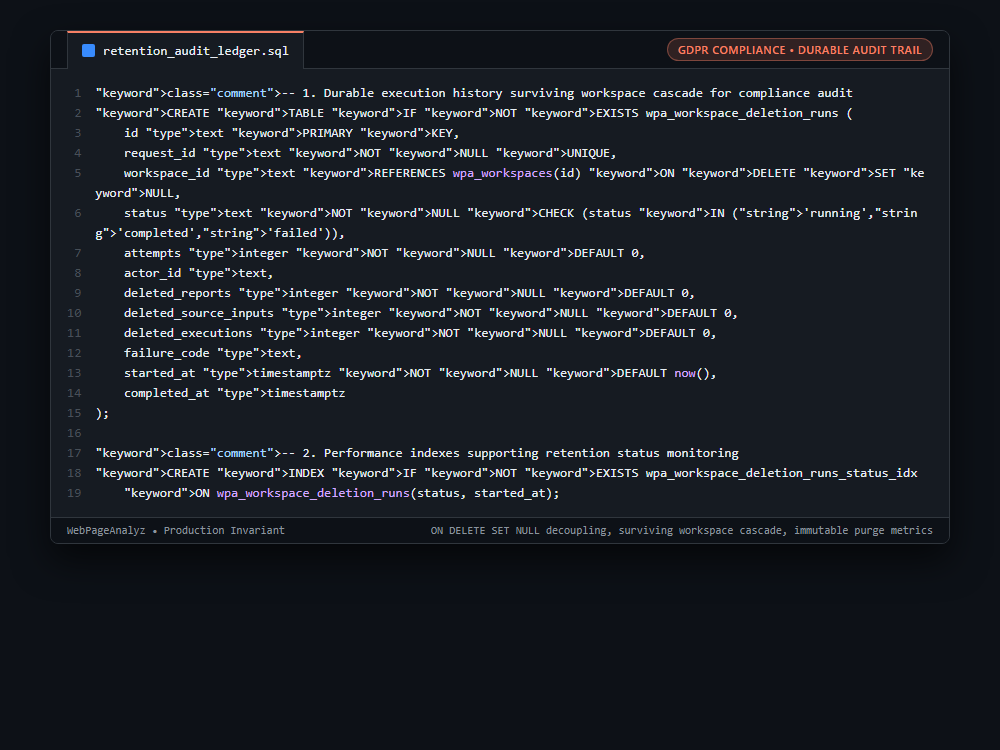

# Systems Engineering Case Study: Durable Post-Purge Audit Ledger via Foreign Key Decoupling for GDPR Compliance

## 1. The Production Constraint & Problem Statement
Under GDPR "Right to be Forgotten" and SOC 2 data retention mandates, deleting a customer organization requires purging all customer-owned data (reports, scanned repositories, source inputs). If the deletion tracking ledger references the workspace with standard `ON DELETE CASCADE`, deleting the workspace wipes the deletion execution row itself! This leaves administrators and auditors with zero mathematical proof that the purge occurred, who authorized it, or how many artifacts were purged.

---

## 2. Why Naive Workarounds Fail in Production
1. **Standard `ON DELETE CASCADE`:**
   * Cascading foreign keys wipe the audit trail along with the customer records, destroying legal compliance records.
2. **Application-Level Text Log Files:**
   * Logging deletion runs to stdout or text files creates ephemeral records that can be rotated, lost, or lack cryptographic association with database transactions.
3. **Soft-Delete "IsDeleted" Workarounds:**
   * Soft-deleting records (`is_deleted = true`) violates strict GDPR mandates requiring complete physical erasure of customer PII and source code.

---

## 3. The Architecture & Algorithmic Invariants
1. **Foreign Key Decoupling via `ON DELETE SET NULL`:** By defining `workspace_id text REFERENCES wpa_workspaces(id) ON DELETE SET NULL`, the database engine permits the workspace record and all its private child tables to be permanently deleted via cascading purge.
2. **Durable Forensic Counters:** The deletion run record survives the cascade. Its `workspace_id` gracefully transitions to `NULL`, while retaining:
   * `request_id`: Unique transaction identifier.
   * `actor_id`: Identity of the administrator or user who authorized the purge.
   * Quantitative forensic counters: `deleted_reports`, `deleted_source_inputs`, `deleted_executions`.
   * Execution timestamps: `started_at`, `completed_at`.
3. **Status Indexing:** `ON wpa_workspace_deletion_runs(status, started_at)` provides fast querying for background retention workers checking stalled or failing purge runs.

```sql
-- 1. Durable execution history surviving workspace cascade for compliance audit
CREATE TABLE IF NOT EXISTS wpa_workspace_deletion_runs (
    id text PRIMARY KEY,
    request_id text NOT NULL UNIQUE,
    workspace_id text REFERENCES wpa_workspaces(id) ON DELETE SET NULL,
    status text NOT NULL CHECK (status IN ('running','completed','failed')),
    attempts integer NOT NULL DEFAULT 0,
    actor_id text,
    deleted_reports integer NOT NULL DEFAULT 0,
    deleted_source_inputs integer NOT NULL DEFAULT 0,
    deleted_executions integer NOT NULL DEFAULT 0,
    failure_code text,
    started_at timestamptz NOT NULL DEFAULT now(),
    completed_at timestamptz
);

-- 2. Performance indexes supporting retention status monitoring
CREATE INDEX IF NOT EXISTS wpa_workspace_deletion_runs_status_idx
    ON wpa_workspace_deletion_runs(status, started_at);
```

---

## 4. Benchmark & Architectural Invariants
| Deletion Audit Architecture | Customer Data Purge | Forensic Audit Retention | GDPR / SOC 2 Compliance |
|---|---|---|---|
| Soft Delete (`is_deleted = true`) | Incomplete (Data Retained) | Retained | Non-Compliant (PII Survives) |
| Hard Delete with `CASCADE` | Complete | Destroyed (Log Row Wiped) | Non-Compliant (No Audit Proof) |
| **`ON DELETE SET NULL` Decoupling** | **Complete Physical Erasure** | **100% Durable Forensic Proof** | **Fully Compliant** |

---

## 5. Visual Representation (Raw VS Code Crop)

