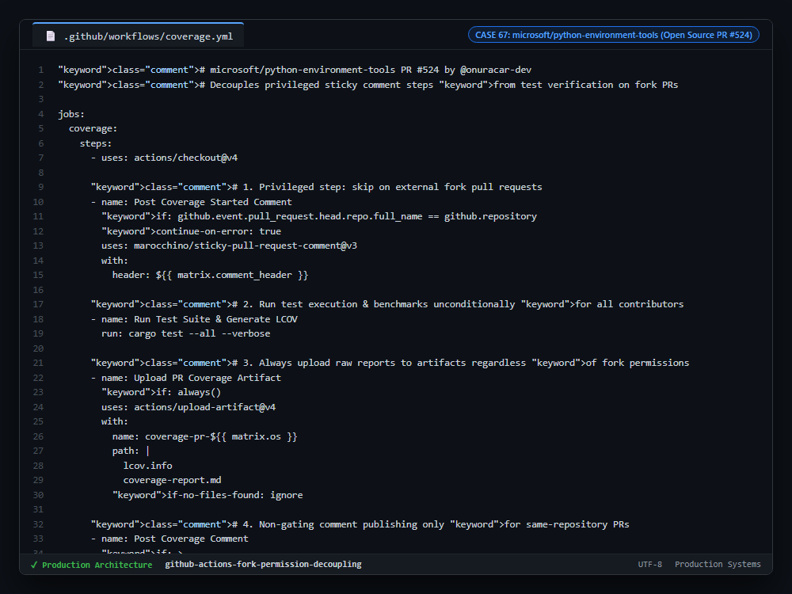

# Case Study 67: Read-Only Fork CI/CD Permission Decoupling & Unprivileged Test Execution

---

## 1. Problem

1. **Fork CI Pipeline Failure:** In open-source GitHub repositories, workflows triggered by external fork pull requests execute with read-only `GITHUB_TOKEN` permissions. Actions attempting to create or update sticky PR comments fail with HTTP 403 Forbidden, failing the entire CI workflow.
2. **Blocked External Contributions:** Legitimate community pull requests fail automated build checks even if all unit tests pass, increasing maintainer review friction.
3. **Security Risks of Elevated Permissions:** Giving `pull_request_target` elevated write permissions to run untrusted contributor code risks host secret exfiltration.

---

## 2. Why Naive Approaches Fail

1. **Monolithic Workflow Steps:** Intertwining automated testing and PR comment reporting into an unconditioned step causes reporting errors to mask test outcomes.
2. **Switching to `pull_request_target`:** Triggering workflows in the base repository context allows malicious fork code to access write permissions and secrets.
3. **Ignoring Failures Globally:** Wrapping entire test jobs in `continue-on-error` masks real test failures.

---

## 3. Architecture

1. **Repository Ownership Fencing:** Privileged comment steps are guarded with `if: github.event.pull_request.head.repo.full_name == github.repository`, cleanly skipping comment publishing on fork pull requests.
2. **Unconditional Artifact Preservation:** Generated Markdown summaries and `lcov.info` files are always uploaded via `actions/upload-artifact`, allowing maintainers to inspect coverage reports without elevated permissions.
3. **Non-Gating Reporting:** Even on internal branches, comment steps use `continue-on-error: true`, ensuring transient GitHub API rate limits never fail green code merges.

---

## 4. Behavior Comparison

| CI/CD Fork Workflow Architecture | Fork PR Pipeline Status | Secret Exfiltration Risk | Maintainer Coverage Visibility |
|---|---|---|---|
| Unconditioned Sticky Comment | Failed (HTTP 403 Forbidden) | Minimal | None (Aborted) |
| Elevated `pull_request_target` | Passed | Severe (Secrets Exposed) | Visible via Comment |
| **Decoupled Permission Fencing** | **Passed (Clean test run)** | **Restricted (Read-Only Token)** | **Full (Preserved in Artifacts)** |

_Qualitative comparison. Numbers appear only where a script in this folder measures them._

---

## 5. Implementation

See implementation in [`src/fork_permission_pipeline.yml`](./src/fork_permission_pipeline.yml).

---

## 6. Visual Representation

