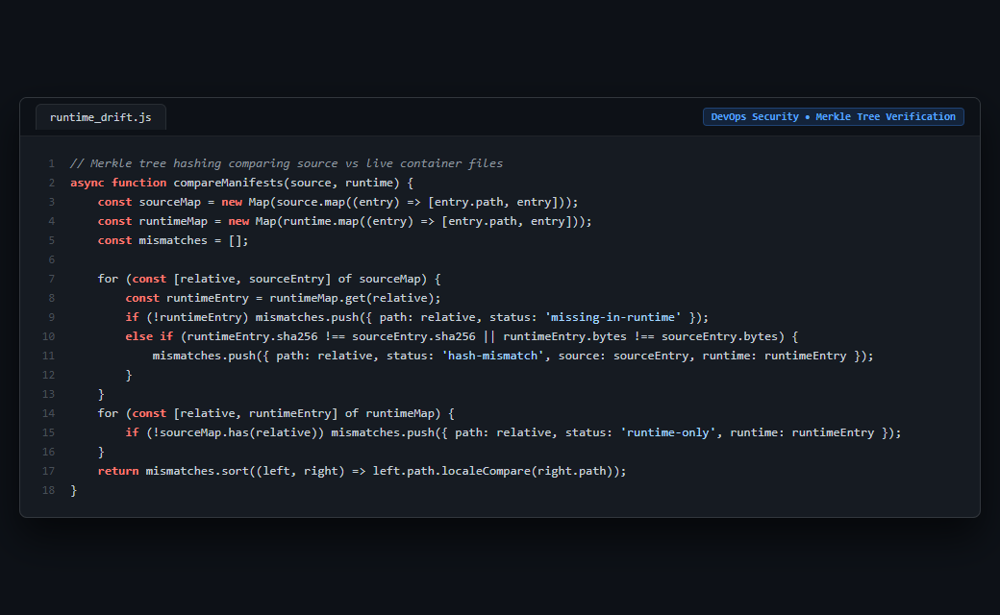

# Case Study 24: Production Runtime Drift Merkle Tree Verification

> **Domain:** DevOps & Disaster Recovery  
> **Source Project:** `WebPageAnalyz (Infra Tooling)`  
> **Language:** Node.js / Crypto  
> **Key Metric:** `SHA-256 Merkle tree comparison, .dockerignore rule classification, migration checksum ledger validation`

---

## 1. Problem

Deploying container images without deterministic verification introduces "runtime drift": files modified directly inside containers by hot-fixes, missing configuration files, untracked development scripts, or tampered database migrations that diverge from checked-in Git repositories.

---

## 2. Why Naive Approaches Fail

1. **Trusting Docker Image Tags (`:latest / :v1.0.0`):**
   * Tags are mutable and provide no cryptographic guarantee regarding what exact code is executing inside running containers.
2. **Manual File Inspection (`docker exec diff`):**
   * Incomplete and error-prone; fails to account for `.dockerignore` exclusions, symlinks, or database schema migration ledgers.
3. **Database Migration State Discrepancies:**
   * Traditional migration runners check which version number ran, but never verify whether someone altered the SQL contents of past migrations.

---

## 3. Architecture

1. **Recursive SHA-256 Tree Hashing:** Traverses directory trees, computing deterministic SHA-256 hashes and byte counts for every deployable source and runtime file.
2. **Rule-Based Exclusion Classification:** Integrates with `.dockerignore` rules (`test-code`, `coverage`, `local-environment`) so legitimate image boundaries are never falsely flagged as drift.
3. **Database Ledger Checksum Verification:** Connects to PostgreSQL, compares `wpa_schema_migrations` SHA-256 hashes against actual migration files on disk, and flags tampering.
4. **Read-Only Non-Destructive Audit:** Executes read-only analysis without modifying live container state.

---

## 4. Behavior Comparison

| Deployment Verification Model | Tampered File Detection | Migration Checksum Verification | .dockerignore Awareness |
|---|---|---|---|
| Image Tag Inspection | None (Blind Trust) | None | None |
| Container Hash Inspection | Coarse (Image ID only) | None | None |
| **Merkle Tree Drift Verifier** | **Cryptographic detection (Per-File SHA-256)** | **Verified against SQL Ledger** | **Rule-Based Classification** |

_Qualitative comparison. Numbers appear only where a script in this folder measures them._

---

## 5. Implementation

See implementation in [`src/runtime_drift.js`](./src/runtime_drift.js).

---

## 6. Visual Representation

