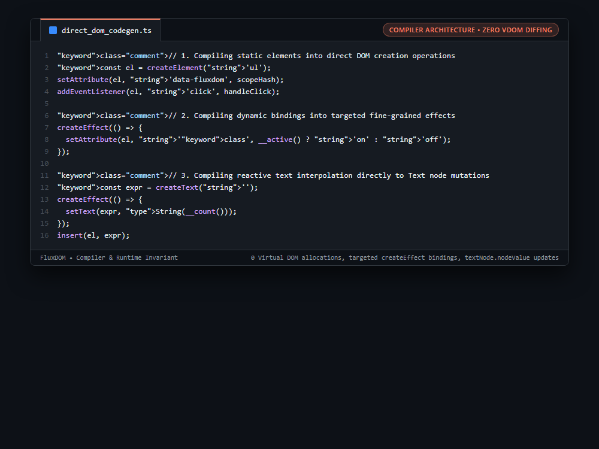

# Systems Engineering Case Study: Direct-to-DOM Compiler Code Generation Bypassing Virtual DOM Tree Diffing

## 1. The Production Constraint & Problem Statement
Traditional Virtual DOM frameworks (like React) represent component templates as nested JavaScript objects (VDOM nodes). On every state update, the component re-executes, re-allocating tree structures in memory and traversing the entire hierarchy to diff changes. For large UI trees, this garbage collector churn and reconciliation overhead limits performance on low-power devices.

---

## 2. Why Naive Workarounds Fail in Production
1. **Heap Allocation Overhead:**
   * Generating thousands of ephemeral VNode objects on every keystroke forces frequent V8 garbage collection pauses.
2. **Whole-Component Re-Execution:**
   * State changes force entire component render functions to re-evaluate, including static subtrees.
3. **Reconciliation Cost:**
   * Comparing old and new virtual trees is O(N) relative to the component size, rather than O(1) relative to the changed state.

---

## 3. The Architecture & Algorithmic Invariants
1. **Compiler-First Transformation:** FluxDOM's template transformer compiles `.flow` components directly into imperative browser DOM calls (`createElement`, `createText`, `insert`).
2. **Fine-Grained Attribute Effects:** Compiles dynamic bindings (`:class="active ? 'on' : 'off'"`) into isolated `createEffect` closures. When `active` changes, only the single `setAttribute` call executes; no parent or child elements are touched.
3. **Surgical Text Node Mutation:** Reactive text interpolations (`{count}`) compile into an initial `createText('')` and an effect updating `text.nodeValue`.
4. **Zero-Diffing Runtime:** Eliminates Virtual DOM libraries entirely, yielding microscopic bundle sizes and instant update dispatch.

```typescript
// 1. Compiling static elements into direct DOM creation operations
const el = createElement('ul');
setAttribute(el, 'data-fluxdom', scopeHash);
addEventListener(el, 'click', handleClick);

// 2. Compiling dynamic bindings into targeted fine-grained effects
createEffect(() => {
  setAttribute(el, 'class', __active() ? 'on' : 'off');
});

// 3. Compiling reactive text interpolation directly to Text node mutations
const expr = createText('');
createEffect(() => {
  setText(expr, String(__count()));
});
insert(el, expr);
```

---

## 4. Benchmark & Architectural Invariants
| Frontend Architecture | Update Complexity | Ephemeral VNode Allocations | Component Re-renders |
|---|---|---|---|
| Virtual DOM (React) | O(Component Tree) | High (New VNodes per Render) | Entire Component |
| Svelte (Invalidation Arrays) | O(Dirty Mask) | Low | Component Scope |
| **FluxDOM Direct-to-DOM Signals** | **O(1) Surgical Mutation** | **Zero VNodes (Direct Text/Attr)** | **Zero Re-renders** |

---

## 5. Visual Representation (Raw VS Code Crop)

