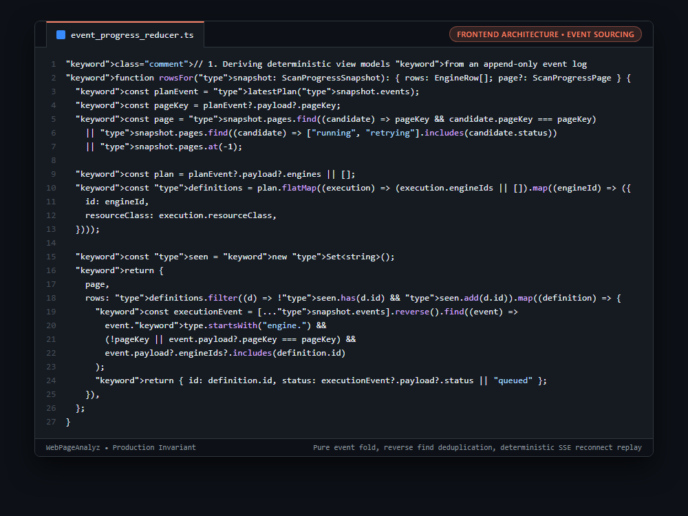

# Systems Engineering Case Study: Event-Sourced Progress Reduction State Machine for Real-Time SSE Streams

---

## 1. Problem

When multi-engine background workflows (running Lighthouse, YellowLab, Axe, ZAP) stream progress events over Server-Sent Events (SSE), network disconnects and packet jitter cause events to arrive out of order or re-deliver upon reconnection. Handling progress via ad-hoc mutable state variables in React (`setEngineAStatus`, `setEngineBStatus`) leads to race conditions, lost error badges, flickering UI transitions, and desynchronized progress bars.

---

## 2. Why Naive Approaches Fail

1. **Ad-Hoc Mutable State Updates:**
   * Updating individual component states on each incoming websocket/SSE message creates cascading React re-renders and out-of-order state corruption.
2. **Reconnection Blindness:**
   * When an SSE connection drops and reconnects with a fresh snapshot or backfilled event log, ad-hoc state cannot reconcile past and future progress deterministically.
3. **Multi-Page Audit Desynchronization:**
   * In multi-page website crawls, events from Page 1 and Page 2 interleave, corrupting single-page progress indicators.

---

## 3. Architecture

1. **Pure Event Reduction State Machine:** Treats UI state as a deterministic projection over an append-only `ScanProgressEvent[]` event log.
2. **Reverse Event Folding:** Evaluates `[...snapshot.events].reverse().find(...)` to locate the latest state for each engine and page. Completed, failed, or retrying states naturally supersede prior queued states.
3. **Execution Plan Alignment:** Matches active engines against the canonical `analysis.plan` payload, ensuring dynamic engine rosters (e.g. Lighthouse vs Axe) accurately reflect server-side dispatch plans.
4. **Resilient Reconnect Invariant:** Because the UI state is a pure function of `(snapshot, events)`, SSE reconnects simply replay or append events, completely eliminating state flicker and race conditions.

```typescript
// 1. Deriving deterministic view models from an append-only event log
function rowsFor(snapshot: ScanProgressSnapshot): { rows: EngineRow[]; page?: ScanProgressPage } {
  const planEvent = latestPlan(snapshot.events);
  const pageKey = planEvent?.payload?.pageKey;
  const page = snapshot.pages.find((candidate) => pageKey && candidate.pageKey === pageKey)
    || snapshot.pages.find((candidate) => ["running", "retrying"].includes(candidate.status))
    || snapshot.pages.at(-1);

  const plan = planEvent?.payload?.engines || [];
  const definitions = plan.flatMap((execution) => (execution.engineIds || []).map((engineId) => ({
    id: engineId,
    resourceClass: execution.resourceClass,
  })));

  const seen = new Set<string>();
  return {
    page,
    rows: definitions.filter((d) => !seen.has(d.id) && seen.add(d.id)).map((definition) => {
      const executionEvent = [...snapshot.events].reverse().find((event) =>
        event.type.startsWith("engine.") &&
        (!pageKey || event.payload?.pageKey === pageKey) &&
        event.payload?.engineIds?.includes(definition.id)
      );
      return { id: definition.id, status: executionEvent?.payload?.status || "queued" };
    }),
  };
}
```

---

## 4. Behavior Comparison

| Progress UI Architecture | Reconnect State Integrity | Out-of-Order Event Handling | Render Jitter |
|---|---|---|---|
| Ad-Hoc `useState` Callbacks | Corrupted / Stuck Progress | Desynchronized UI | High (Cascading Rerenders) |
| Imperative DOM Mutation | Lost on Component Remount | Fragile | Visual Glitches |
| **Pure Event Fold State Machine** | **Deterministic state replay** | **Naturally Resolved (Reverse Fold)** | **Minimal (Atomic snapshot projection)** |

_Qualitative comparison. Numbers appear only where a script in this folder measures them._

---

## 5. Implementation

See implementation in [`src/event_progress_reducer.ts`](./src/event_progress_reducer.ts).

---

## 6. Visual Representation


