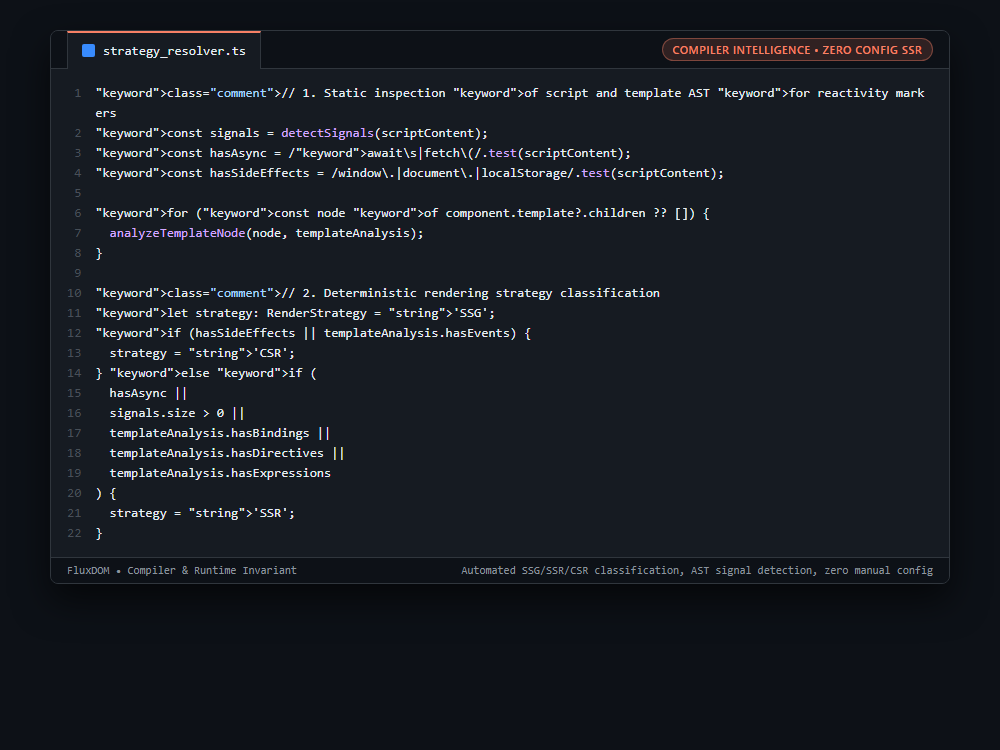

# Systems Engineering Case Study: Static AST Inspection for Automatic SSG/SSR/CSR Strategy Resolution

## 1. The Production Constraint & Problem Statement
In modern full-stack web applications, developers must manually annotate which pages or components should be statically generated (SSG), server-rendered (SSR), or client-rendered (CSR). Human error frequently leads to pages with client-only APIs (`window`, `localStorage`) failing during SSR builds, or purely static marketing pages wasting server compute because they were unnecessarily configured for dynamic SSR.

---

## 2. Why Naive Workarounds Fail in Production
1. **Manual Framework Directives (`use client` / `ssr: false`):**
   * Relies on developer memory and discipline; missing an annotation causes hydration crashes in production.
2. **Runtime Detection Penalties:**
   * Detecting client capabilities at runtime introduces layout shifts (CLS) and extra loading spinners.
3. **Unnecessary Server Render Costs:**
   * Rendering static pages on every HTTP request wastes server memory and increases Time-to-First-Byte (TTFB).

---

## 3. The Architecture & Algorithmic Invariants
1. **AST AST Analysis Pass:** `analyze()` evaluates both script declarations and template nodes:
   * Detects reactive signal declarations (`let count = 0`).
   * Detects asynchronous operations (`await`, `fetch()`).
   * Detects browser side-effects (`window.`, `document.`, `localStorage`).
2. **Template Directive Traversal:** Inspects nodes for dynamic bindings (`:class`), event listeners (`@click`), and structural directives (`{#if}`, `{#each}`).
3. **Deterministic Strategy Classification:**
   * If browser globals or event listeners exist -> Automatically assigns `CSR`.
   * If async calls, signals, or bindings exist -> Automatically assigns `SSR`.
   * If zero signals, zero events, and zero side-effects exist -> Automatically promotes to `SSG` (Static Site Generation).
4. **Metadata Code Generation:** Emits `export const __flowStrategy = 'SSG';` directly into the compiled output for build tool integration.

```typescript
// 1. Static inspection of script and template AST for reactivity markers
const signals = detectSignals(scriptContent);
const hasAsync = /await\s|fetch\(/.test(scriptContent);
const hasSideEffects = /window\.|document\.|localStorage/.test(scriptContent);

for (const node of component.template?.children ?? []) {
  analyzeTemplateNode(node, templateAnalysis);
}

// 2. Deterministic rendering strategy classification
let strategy: RenderStrategy = 'SSG';
if (hasSideEffects || templateAnalysis.hasEvents) {
  strategy = 'CSR';
} else if (
  hasAsync ||
  signals.size > 0 ||
  templateAnalysis.hasBindings ||
  templateAnalysis.hasDirectives ||
  templateAnalysis.hasExpressions
) {
  strategy = 'SSR';
}
```

---

## 4. Benchmark & Architectural Invariants
| Strategy Selection | Human Configuration Overhead | Hydration Crash Risk | Server Resource Optimization |
|---|---|---|---|
| Manual Directives (`use client`) | High (Manual per file) | Frequent (Forgotten Directives) | Sub-optimal |
| Pure Runtime Fallback | Medium | Layout Shift (CLS) | Poor |
| **Static AST Resolution** | **Zero (Automated Compiler)** | **Zero (Compiler Verified)** | **100% Optimal (Auto-SSG)** |

---

## 5. Visual Representation (Raw VS Code Crop)

